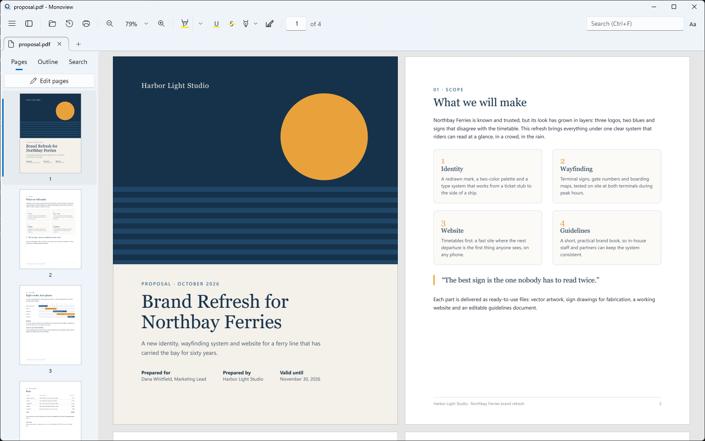
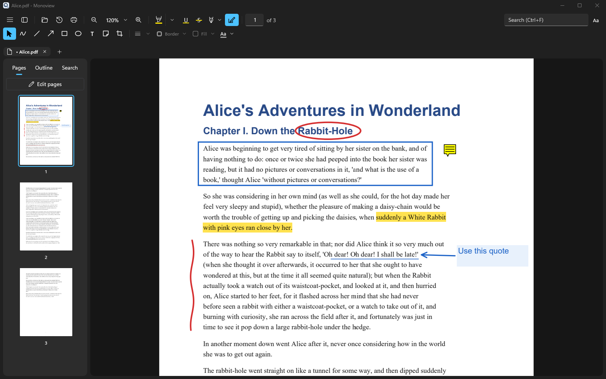
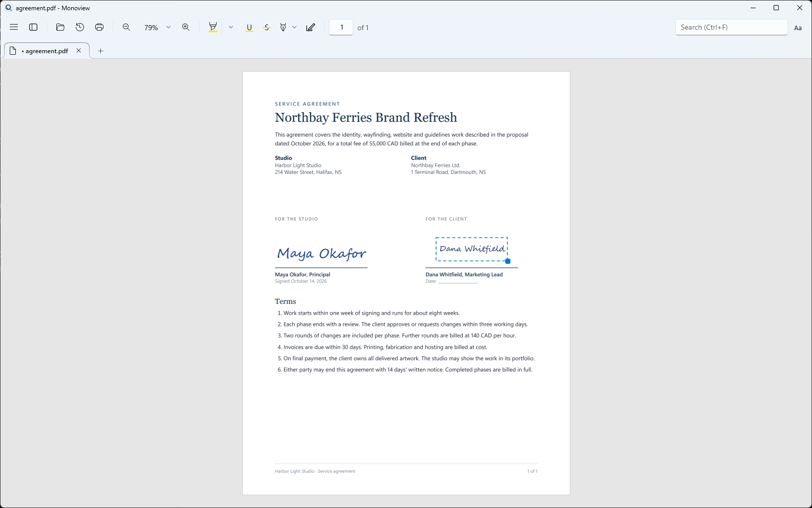
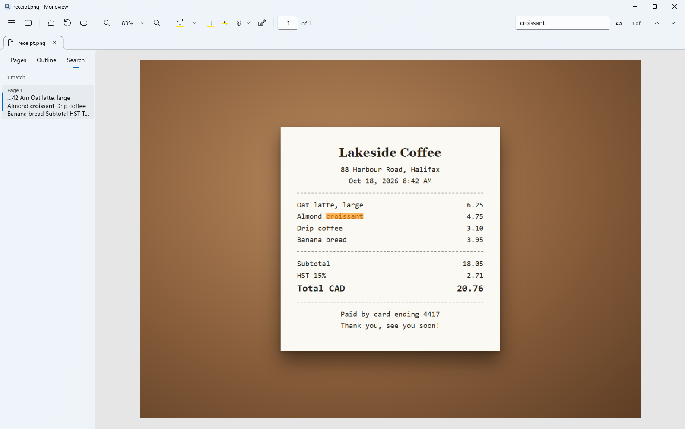
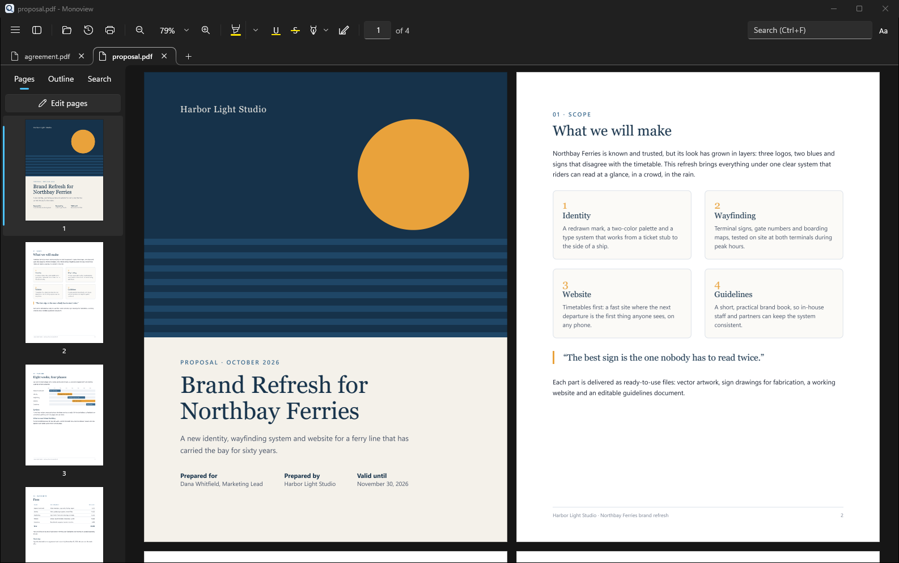

<div align="center">


# Monoview

**A fast, clean PDF viewer and editor for Windows, modeled on macOS Preview.**

<sub>Open a PDF, read it, mark it up, sign it, fill it in, and get on with your day.</sub>

<br>

[](LICENSE)
[](#download)
[](https://dotnet.microsoft.com/)
[](https://learn.microsoft.com/windows/apps/winui/winui3/)
[](https://pdfium.googlesource.com/pdfium/)

<br>

<a href="https://apps.microsoft.com/detail/9N8G6JSG2MH6?mode=direct"></a>

<br>



<br>

[Features](#features) · [Screenshots](#screenshots) · [Shortcuts](#keyboard-shortcuts) · [Download](#download) · [Build](#build-from-source) · [License](#license)

</div>

---

## Why Monoview

Most PDF apps on Windows are slow to open, crowded with panels and keen to sell you a subscription. macOS has Preview: it opens at once, gets out of the way, and still does the everyday jobs well.

Monoview brings that to Windows. It is a native WinUI 3 app built on PDFium, the engine inside Chrome. It renders only the pages you see, so big files stay smooth. Everything you add is saved as standard PDF annotations, so Acrobat, Edge and Preview show your highlights, notes and signatures too. There is no account, no ads and no telemetry, and form scripts never run.

## Features

### 📖 Reading
- Continuous scroll with tiled rendering; only visible pages are drawn.
- Zoom like Acrobat: Ctrl+scroll around the pointer, touchpad pinch, fit width, fit page and actual size.
- Single page and two-page views, view rotation, full screen and middle-click autoscroll.
- Clickable links with Back and Forward, the document outline, and page thumbnails.
- Search that ignores case, accents and line breaks, with match case and whole word options.
- Files reopen at the page you left. Light and dark themes.

### ✍️ Markup
- Highlight, underline and strikethrough in five colors or any color you pick.
- The markup bar (Ctrl+Shift+A): freehand drawing, lines, arrows, rectangles, ellipses, text boxes and sticky notes.
- Line color, fill, line width and text size.
- Select any object to move, resize or delete it.

### 🖋️ Signatures
- Draw your signature, type it in a handwriting font, or use a photo of it; the paper becomes transparent.
- Saved signatures are one click away. Place, move and resize them on the page.

### 📝 Forms
- Fill text fields, check boxes, radio buttons, drop-downs and lists.
- Tab between fields. Copy and paste work inside them.

### 📄 Pages
- Edit pages mode keeps the sidebar read-only until you turn it on, so a stray drag can't change your file.
- Reorder by dragging, delete, rotate, crop, and insert pages from a PDF, a password-protected PDF or a picture.
- Drag pages from one document into another, even across windows.
- Extract pages to a new PDF, or export them as PNG or JPEG.

### 🗂️ Tabs and windows
- Tabs that drag to reorder, move between windows, or tear out into their own window.
- Ctrl+Shift+T reopens a closed tab. Files you open from Explorer go to the window you used last.

### 🖼️ Pictures and live text
- Open PNG and JPG files like PDFs, and save them as PDF.
- Text in scans and pictures is read with Windows OCR, so you can select, copy and search it.

### 💾 Safe by default
- Undo and redo for every edit.
- Save writes a temporary file and swaps it in, so a failed save never damages the original.
- Password protection is kept when you save. Printing uses the Windows print dialog with a live preview.

## Screenshots

<table>
  <tr>
    <td width="50%"></td>
    <td width="50%"></td>
  </tr>
  <tr>
    <td><b>Markup bar.</b> Draw, add shapes, text boxes and notes, then move or resize them.</td>
    <td><b>Signatures.</b> Draw, type or import a signature, then place it with one click.</td>
  </tr>
  <tr>
    <td width="50%"></td>
    <td width="50%"></td>
  </tr>
  <tr>
    <td><b>Live text.</b> Search, select and copy text in pictures and scans.</td>
    <td><b>Dark theme and tabs.</b> Open many documents and read spreads side by side.</td>
  </tr>
</table>

## Keyboard shortcuts

<table>
<tr>
<td valign="top">

**Files and tabs**

| Keys | Action |
|---|---|
| <kbd>Ctrl</kbd>+<kbd>O</kbd> | Open |
| <kbd>Ctrl</kbd>+<kbd>S</kbd> | Save |
| <kbd>Ctrl</kbd>+<kbd>Shift</kbd>+<kbd>S</kbd> | Save as |
| <kbd>Ctrl</kbd>+<kbd>P</kbd> | Print |
| <kbd>Ctrl</kbd>+<kbd>W</kbd> | Close tab |
| <kbd>Ctrl</kbd>+<kbd>Shift</kbd>+<kbd>T</kbd> | Reopen closed tab |
| <kbd>Ctrl</kbd>+<kbd>Tab</kbd> | Next tab |
| <kbd>Ctrl</kbd>+<kbd>N</kbd> | New window |

</td>
<td valign="top">

**View**

| Keys | Action |
|---|---|
| <kbd>Ctrl</kbd>+scroll | Zoom around the pointer |
| <kbd>Ctrl</kbd>+<kbd>0</kbd> | Actual size |
| <kbd>Ctrl</kbd>+<kbd>8</kbd> / <kbd>9</kbd> | Fit width / fit page |
| <kbd>Ctrl</kbd>+<kbd>B</kbd> | Show or hide the sidebar |
| <kbd>Ctrl</kbd>+<kbd>G</kbd> | Go to page |
| <kbd>Ctrl</kbd>+<kbd>F</kbd> | Search |
| <kbd>Alt</kbd>+<kbd>←</kbd> / <kbd>→</kbd> | Back / forward |
| <kbd>F11</kbd> | Full screen |

</td>
<td valign="top">

**Edit**

| Keys | Action |
|---|---|
| <kbd>Ctrl</kbd>+<kbd>H</kbd> | Highlight |
| <kbd>Ctrl</kbd>+<kbd>Shift</kbd>+<kbd>A</kbd> | Markup bar |
| <kbd>Ctrl</kbd>+<kbd>Z</kbd> | Undo |
| <kbd>Ctrl</kbd>+<kbd>Y</kbd> | Redo |
| <kbd>Delete</kbd> | Delete selected object |
| <kbd>Esc</kbd> | Back to select |
| <kbd>Tab</kbd> | Next form field |
| <kbd>F1</kbd> | All shortcuts |

</td>
</tr>
</table>

## Download

<a href="https://apps.microsoft.com/detail/9N8G6JSG2MH6?mode=direct"></a>

The [Microsoft Store](https://apps.microsoft.com/detail/9N8G6JSG2MH6) is the easiest way to install Monoview. It runs on x64 and ARM64, updates automatically and shows no SmartScreen warning.

Or get the latest version from [GitHub Releases](https://github.com/mfmyip/Monoview/releases):

| File | What it is |
|---|---|
| `Monoview-x.y.z-win-x64.msi` | The installer. It installs for you only, with no admin prompt, adds Monoview to the Start menu and to "Open with" for PDF, PNG and JPG, and uninstalls from Settings > Apps. |
| `Monoview-x.y.z-win-x64.zip` | The portable app. Unzip it anywhere and run `Monoview.exe`; nothing is installed. |

To make Monoview your default PDF app, pick it in Settings > Apps > Default apps.

> **Windows SmartScreen:** the builds are not code-signed yet, so Windows may show "Windows protected your PC" the first time. Click **More info**, then **Run anyway**.

**Requirements:** Windows 10 version 1809 or later, or Windows 11, on x64. The app is self-contained, so you don't need to install .NET.

## Build from source

You need the [.NET 9 SDK](https://dotnet.microsoft.com/download/dotnet/9.0).

```powershell
git clone https://github.com/mfmyip/Monoview.git
cd Monoview
dotnet publish src/Monoview.App -c Release -p:Platform=x64 -r win-x64 -o publish/win-x64
publish\win-x64\Monoview.exe
```

Build a release, the portable zip and the installer, into `artifacts\`. The version comes from `src/Monoview.App/Monoview.App.csproj`:

```powershell
powershell -ExecutionPolicy Bypass -File build-release.ps1
```

Run the engine tests:

```powershell
dotnet test tests/Monoview.Engine.Tests
```

| Folder | What it holds |
|---|---|
| `src/Monoview.Engine` | The PDFium wrapper: rendering, text, search, annotations, forms, page operations and saving. No UI code. |
| `src/Monoview.App` | The WinUI 3 app: windows, tabs, toolbar, sidebar, the page viewer and dialogs. |
| `tests/Monoview.Engine.Tests` | Engine tests. They generate their own PDFs, so no sample files are needed. |
| `tests/Monoview.Benchmarks` | A startup benchmark that measures the time to the first sharp page. |

## Roadmap

- Redaction that truly removes content, not just covers it.
- More shapes: rounded rectangles, speech bubbles, stars and polygons.
- Font, bold and italic for text boxes; dashed lines and arrow ends.
- A winget package and a signed build.

## Credits

- [PDFium](https://pdfium.googlesource.com/pdfium/), the PDF engine, by the PDFium Authors.
- [PDFiumCore](https://github.com/Dtronix/PDFiumCore), the .NET bindings, by Dtronix.
- [pdfium-binaries](https://github.com/bblanchon/pdfium-binaries), the PDFium builds, by Benoît Blanchon.
- [Windows App SDK](https://github.com/microsoft/windowsappsdk) and WinUI 3, by Microsoft.
- Inspired by Preview on macOS.

See [THIRD_PARTY_NOTICES.md](THIRD_PARTY_NOTICES.md) for their licenses.

## License

Monoview is released under the [MIT License](LICENSE).
